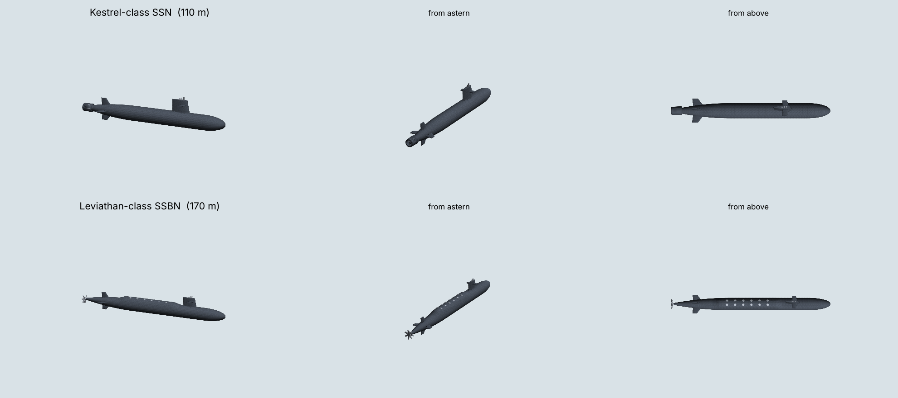

# Submarines for Nuclear Option

A BepInEx 5 plugin that adds two submarines to Nuclear Option:

| Unit | jsonKey | Role |
|---|---|---|
| Kestrel-class SSN | `SUB_SSN_Kestrel` | Attack sub. 18 wire-guided heavyweight torpedoes, hunts ships and other subs. |
| Leviathan-class SSBN | `SUB_SSBN_Leviathan` | Ballistic missile sub. 12 SLBMs, nuclear or conventional (stock ballistic missiles), 6 torpedoes for self defence. |

Both show up in the mission editor's ship list like any stock ship.



> **Status: untested in game.** I wrote this without a copy of the game, so it has never been
> loaded into Nuclear Option. The game API calls come from other open source NO mods (MK-88
> Hydra, MK-65 Crosswim, Blueprinter, PlayableVehicles, DetectionDisable), and the code
> type-checks against stubs of that API (`tools/check.sh`). Expect a round of fixing the first
> time it meets the real `Assembly-CSharp.dll`. The "Known risks" section below lists the likely
> problems.

## How it works

### Model

Each sub has its own 3D model, generated from code at startup (`src/Visual/HullGeometry.cs`).
The SSN gets a pump-jet with stator vanes; the SSBN gets a 7-blade propeller and a raised missile
deck with 12 hatches. Both have a cruciform stern, a sail with fairwater planes and mast stubs,
and an anechoic near-black finish. The mod builds the meshes itself, so no asset bundle has to be
shipped or downloaded, and everyone with the mod sees exactly the same boat.

`tools/geom/export.sh` runs that same geometry code under mono and writes the meshes to
`models/*.obj`, so you can open them in Blender. The preview above was rendered from those files.

### Hulls

At `Encyclopedia.AfterLoad` the mod clones a stock warship prefab for each sub, gives the clone
a new `ShipDefinition` and its own Mirage prefab hash, swaps the donor's visuals for the sub
model and registers it. The donor's renderers, smoke and lights are switched off (and kept off),
but its colliders, damage model and AI stay, since that's what makes the sub behave like a real
unit. Because each sub has its own prefab, saves, the editor and multiplayer spawns keep it
separate from the donor ship.

The donor comes from keywords in the config (`corvette,frigate,destroyer` for the SSN by
default). On startup the BepInEx log lists every stock ship and missile with its jsonKey.

### Diving

Ships float on stock buoyancy. The sub fights that with a depth controller that commands
vertical speed and runs a disturbance observer: it measures how hard buoyancy and waves push
the hull and cancels that push. A second loop keeps the hull level. Depths: periscope 11 m (sail just under, masts out),
patrol 120 m, max 300 m, and the boat always stays 25 m above the seabed.

### Staying off radar

Two Harmony prefixes on `DetectorManager.RequestRadarCheck` and `RequestLoSCheck` decide what
sensors can see:

- **Below periscope depth:** no radar return and nothing to see. Turrets can't lock on
  (`Turret_OnDetectTarget` is blocked too).
- **At periscope depth:** the masts stick out. Radar within 9 km and eyes within 2.5 km can
  still pick them up.
- **Surfaced:** a normal ship.

A submerged sub's own radar and turrets are under water, so they go quiet as well.

### Sonar

Every sub, and by default every stock warship, carries a `SonarArray`. It runs a simplified
sonar equation every 2 seconds:

```
passive SE = SL - TL - NL + DI - DT
active  SE = 220 - 2*TL + TS - NL + DI - DT
TL = 20 log10(r) + 0.5 dB/km, + 14 dB if the thermocline (60 m) is between you
```

Subs are quiet (102 to 108 dB at 5 kn) and get louder with speed, at shallow depth and when
surfaced. A destroyer at 20 kn comes out around 145 dB. Passive tracks start with a good
bearing and a bad range, and the range tightens over about 40 seconds of tracking. An active
ping gives range at once, but every hostile array within 55 km hears the ping and gets a
bearing on whoever sent it.

When the server holds a firm track on a hostile unit, it calls `FactionHQ.RpcUpdateTrackingInfo`,
so sonar contacts show up on the faction map like radar contacts.

### Spoofing enemy sonar

Each boat carries 8 decoys and an acoustic mimicry mode:

- **Noisemaker.** A loud broadband source at about 138 dB. Any array that hears the noisemaker
  on roughly the same bearing as the boat loses the boat, and torpedo seekers go for whatever
  is loudest. A noisemaker sits still in the water, though, and after about 25 seconds of good
  tracking a sonar operator works that out and labels it `DECOY`.
- **Repeater.** Plays back the boat's own signature 6 dB louder and answers active pings, from a
  phantom position that slides away from the boat up to 1.8 km (range-gate pull-off). Enemy
  sonar sees a moving submarine contact that isn't there. Torpedoes chase it, find nothing,
  and re-attack. Ships fire ASW torpedoes at it.
- **Mimicry.** For 90 seconds the boat sounds like merchant traffic (`MERCH`), so passive arrays
  don't report it and AI won't shoot at it. Active pings and torpedo seekers aren't fooled.

The AI uses all of this on its own. When it hears a torpedo inside 6 km it drops a decoy and
jumps across the thermocline. When it gets pinged it switches on mimicry and drops a repeater.

### Weapons

- **Torpedoes** are scripted and run on the server only. They aren't game units, so radar never
  sees them. Each one runs on the wire toward the launcher's track, switches on its seeker
  3 km out, and homes on the loudest hostile source in a 40° cone. A hit applies damage directly
  to the hull parts in the bubble radius, then spawns and detonates a stock missile at the
  waterline so every client sees the explosion. You can turn that last part off with
  `StockWarheadVisuals`.
- **SLBMs.** The SSBN climbs to 30 m, cold-launches a stock ballistic missile up out of the
  water, and aims it at the best enemy building or ship its faction has a known position for,
  between 8 km and 150 km away. Every launch makes a loud transient that gives away its
  position.
- **Nuclear SLBMs.** At startup the mod sorts the stock ballistic missiles by their weapon info
  into a nuclear one and a conventional one, and logs which it picked. Each SSBN has a warhead
  setting (`BallisticWarhead` in the config, and players can change it per boat):
  - `Nuclear` (default): fires nuclear when release is allowed, otherwise conventional.
  - `NuclearOnly`: fires nuclear or holds fire.
  - `Conventional`: never nuclear.

  A nuclear launch follows the same rules as the stock game. The mission has to have escalated
  to tactical (or strategic, if the missile is flagged strategic) nuclear use, and the faction
  needs a warhead in its stockpile. Each launch takes one warhead out of airbase storage.
  The sub also won't fire a nuke at a target with friendly units within 3 km
  (`NuclearSafetyRadius`). Set `RespectNuclearRules = false` to skip escalation and the stockpile.
- **Surface ASW.** Stock warships with sonar ping when a hostile sub is within 30 km, and they
  fire up to 6 ASW torpedoes at firm submarine contacts within 9 km. Without them a submerged
  boat would be invulnerable.

### Sonar display (F8)

A small plot in the bottom left shows what your sub's sonar believes, decoys and phantoms
included. For an SSBN it also shows the warhead setting, the faction's stockpile, and whether
the next launch will be nuclear, conventional, or held (and why). Ctrl+F8 cycles the range (10/30/60 km), and F9 picks the next boat.

| Key | Order |
|---|---|
| PageDown / PageUp | 20 m deeper / shallower (takes the boat off AI control) |
| Shift+F9 | Hand the boat back to the AI |
| Insert | Torpedo at the best hostile contact |
| Delete | Decoy (noisemaker and repeater alternate) |
| End | Acoustic mimicry |
| Home | SSBN: climb to launch depth and fire at the best known target |
| Backslash | SSBN: cycle warhead (conventional, nuclear, nuclear only) |
| Pause | Active ping |

In multiplayer, a client's orders go to the host, which checks the boat belongs to that player's
faction, runs the order, and sends back the result line.

## Multiplayer

Everyone in the lobby needs the mod installed, at the same version. Here's what each player
sees and how it gets there:

| What | How it reaches other players |
|---|---|
| The sub itself | A normal networked unit. The host spawns it from the registered prefab, and each client builds the model locally. The prefab hash is worked out the same way on every machine. |
| Sub position and depth | The game's own ship sync. The host also sends each sub's depth twice a second. If a client simulates the hull physics itself, it holds that depth so the boat doesn't bob up between updates. |
| Ammo, depth orders, mimicry state | `SubNet` state messages, twice a second per boat. |
| Torpedoes | Position and heading 4 times a second. Clients dead-reckon between updates and draw a torpedo model. |
| Decoys | One spawn message. Their motion is deterministic, so each client runs it locally, and enemy decoys fool a client's sonar display the same way they fool the host's. |
| Explosions, SLBMs | Stock networked missiles, so the game syncs them. |
| Player orders | Client sends to host, host validates and replies. |

`SubNet` uses Mirage custom messages, the same approach PlayableVehicles uses. A client with a
different network version gets a warning in the host's log and no sub sync.

A player without the mod can't spawn the sub prefab when the host sends it. Expect errors or
a disconnect for them.

## Install

1. Install BepInEx 5 (x64) into the Nuclear Option folder.
2. Build (below) and put `Submarines.dll` in `BepInEx/plugins/Submarines/`.
3. Launch once. Check `BepInEx/LogOutput.log` for `Registered Kestrel-class SSN` and look at
   the ship and missile list it prints.
4. Tune `BepInEx/config/com.badnew21.submarines.cfg` if you want to (donor hulls, missile
   keywords, depths, ranges, damage, keys).

## Build

```bash
cp Directory.Build.props.template Directory.Build.props
```

Edit `NuclearOptionRoot` in that file to point at your game folder, then:

```bash
dotnet build -c Release
```

The Release build copies the DLL into `BepInEx/plugins/Submarines/` for you.

To type-check without the game (mono `mcs` only):

```bash
./tools/check.sh
```

To export the models to OBJ:

```bash
./tools/geom/export.sh
```

## Known risks

These are the places most likely to break on first contact with the real game:

- **Cloned network prefab.** The other mods only clone mount prefabs that have no
  `NetworkIdentity`. Here a whole ship gets cloned under an inactive holder with a fresh prefab
  hash. If Mirage rejects that on spawn, switching to a Blueprinter `.nobp` hull is the fallback.
- **Stock damage or flooding logic** might treat a hull below the waterline as sinking.
- **Depth controller gains** were picked on paper. If the boat porpoises, lower the vertical
  speed. If it can't hold depth, the observer gain in `Submarine.FixedUpdate` needs a bump.
- **Damage numbers.** I don't know stock ship hitpoints, so `TorpedoDamage` might kill too fast
  or too slow.
- **Method names patched by string** (`AfterLoad`, `RegisterPrefabs`, `InitializeUnit`,
  `RequestRadarCheck`, `RequestLoSCheck`, `Turret_OnDetectTarget`). Each patch is applied
  separately, so a renamed method only switches off that one feature and logs an error.
- **Colliders are the donor's.** Hits and damage use the donor ship's colliders, which won't
  match the sub's shape exactly. Replacing them would mean rebuilding its damage parts.
- **Waterline.** The model assumes the donor's origin sits at its waterline. If the surfaced sub
  floats too high or too low, adjust `[Model] VerticalOffset`.
- **Materials.** The model copies a lit material from the donor (the game uses URP). If the sub
  shows up pink or invisible, that lookup failed. Check the log.
- **Nuclear missile detection.** The mod decides a missile is nuclear from its weapon info's
  `nuclear` flag, found through the weapon mount that carries it. If the log says
  `nuclear=none`, that lookup failed. Warheads are taken from airbase storage the same way
  PlayableVehicles does it. If the stockpile also counts warheads somewhere else, the log warns
  that no airbase had one to remove.
- **Multiplayer messages.** The `SubNet` messages follow PlayableVehicles' working pattern, but
  nobody has run them in a real lobby yet.
